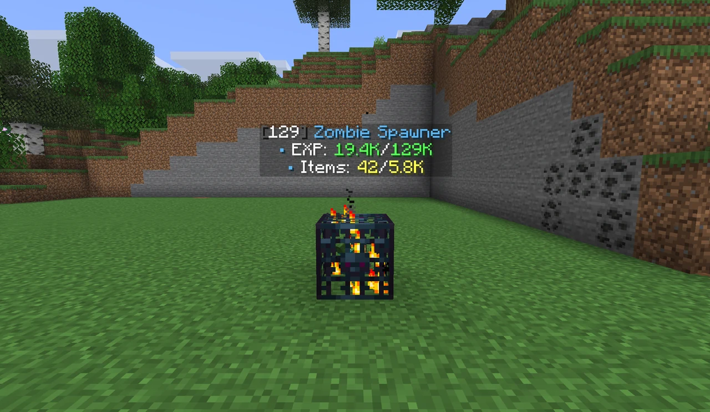

<div align="center">


[](https://modrinth.com/plugin/smartspawner)
[](https://hangar.papermc.io/Nighter/SmartSpawner)
[](https://docs.smartspawner.site/)

Spawners that generate drops and experience without spawning mobs, for **Paper** and **Folia**.

</div>

## Overview
* **Virtual Drops:** Drops and experience go straight into the spawner's storage, without spawning a single mob.
* **Spawner Menu:** Open storage, collect experience and manage the stack from one menu. Storage is paged, sortable, filterable and sellable.
* **Stacking:** Right-click a spawner with another of the same type to stack it, or sneak to add a whole stack at once. Drops and experience scale with the stack.
* **Spawner Types:** Mob spawners, item spawners that generate materials such as diamonds, and custom spawners with their own loot and name.
* **Admin Tools:** Browse every spawner by world, teleport to it, edit or remove it, and log actions to files or Discord.

Every feature is explained on the [documentation site](https://docs.smartspawner.site/).

<div align="center">
<table>
  <tr>
    <td align="center"></td>
    <td align="center"></td>
  </tr>
</table>
</div>

## Requirements

| Minecraft | Java | Server software |
| :--- | :---: | :--- |
| 26.1 – 26.2 | 25 | Paper, Folia, Purpur or compatible forks |
| 1.21.6 – 1.21.11 | 21 | Paper, Folia, Purpur or compatible forks |

One jar runs on every version listed. The ExcellentEconomy integration needs Java 25, as ExcellentEconomy itself does.

## Compatibility
All integrations are soft dependencies: nothing is required, and each one turns on only when its plugin is installed.

| Function | Plugins | What SmartSpawner does |
| :--- | :--- | :--- |
| **Shop prices** |  [EconomyShopGUI](https://docs.smartspawner.site/docs/integrations/shops/economyshopgui)<br> [ShopGUI+](https://docs.smartspawner.site/docs/integrations/shops/shopguiplus)<br> [zShop](https://docs.smartspawner.site/docs/integrations/shops/zshop) | Prices the items sold from spawner storage |
| **Economy** |  [Vault](https://docs.smartspawner.site/docs/integrations/shops/vault)<br> [ExcellentEconomy](https://docs.smartspawner.site/docs/integrations/shops/excellenteconomy) (Java 25) | Pays players when they sell |
| **Protection and claims** |  [WorldGuard](https://docs.smartspawner.site/docs/integrations/protections/worldguard)<br> [GriefPrevention](https://docs.smartspawner.site/docs/integrations/protections/griefprevention)<br> [Lands](https://docs.smartspawner.site/docs/integrations/protections/lands)<br> [Towny](https://docs.smartspawner.site/docs/integrations/protections/towny)<br> [Residence](https://docs.smartspawner.site/docs/integrations/protections/residence)<br> [RedProtect](https://docs.smartspawner.site/docs/integrations/protections/redprotect)<br> [SimpleClaimSystem](https://docs.smartspawner.site/docs/integrations/protections/simpleclaimsystem)<br> [FactionsUUID](https://docs.smartspawner.site/docs/integrations/protections/factionsuuid)<br> [BlockLocker](https://docs.smartspawner.site/docs/integrations/protections/blocklocker) | Checks region and claim permissions before a spawner is opened, stacked or broken |
| **Islands and plots** |  [SuperiorSkyblock2](https://docs.smartspawner.site/docs/integrations/islands/superiorskyblock2)<br> [BentoBox](https://docs.smartspawner.site/docs/integrations/islands/bentobox)<br> [IridiumSkyblock](https://docs.smartspawner.site/docs/integrations/islands/iridiumskyblock)<br> [PlotSquared](https://docs.smartspawner.site/docs/integrations/islands/plotsquared)<br> [minePlots](https://docs.smartspawner.site/docs/integrations/islands/mineplots) | Applies island and plot permissions to spawner actions |
| **Skills** |  [AuraSkills](https://docs.smartspawner.site/docs/integrations/auraskills) | Turns claimed spawner experience into skill XP |
| **Custom mobs** |  [MythicMobs](https://docs.smartspawner.site/docs/integrations/mythicmobs) | Drops spawner items from MythicMobs drop tables |

Setup for each plugin is in the [integrations guide](https://docs.smartspawner.site/docs/integrations/).

## Configuration
* **Files:** `plugins/SmartSpawner/`. `config.yml` for the main settings, `spawner_mobs.yml` and `spawner_items.yml` for loot, `sell_integration.yml` for selling, `activity_log.yml` for logging.
* **Menus and text:** Every message and menu text is editable in `language/` and `gui_layouts/`, with MiniMessage colours.
* **Storage:** SQLite by default, MySQL or MariaDB for networks.
* **Reference:** Every key is documented on the [configuration page](https://docs.smartspawner.site/docs/configuration).

## Commands
Aliases: `/ss`, `/spawner`, `/smartspawner`. Each command has its own permission, listed on the [permissions page](https://docs.smartspawner.site/docs/permissions).

| Command | Description |
| :--- | :--- |
| `/ss give <player> <spawner> [amount]` | Give a mob, item or custom spawner |
| `/ss give <player> vanilla <mob> [amount]` | Give a vanilla spawner |
| `/ss list` | Browse, teleport to and manage every spawner |
| `/ss near [radius]` | Highlight nearby spawners through walls |
| `/ss editloot <spawner>` | Edit a spawner's loot in game |
| `/ss set <stack_size\|range\|delay> <value>` | Change the spawner being looked at |
| `/ss prices` | Show the sell price of every spawner drop |
| `/ss hologram` | Turn holograms on or off |
| `/ss language <locale>` / `/ss gui_layout <layout>` | Switch language or menu layout |
| `/ss reload` | Reload every config file |

Placing and opening a spawner need no permission at all. If players cannot place spawners, another plugin is blocking it.

## For Developers

**Java API:** Create spawner items, read spawner data and listen to spawner events. Add it from [JitPack](https://jitpack.io/#OpenVdra/SmartSpawner/):

```groovy
repositories { maven { url 'https://jitpack.io' } }
dependencies { compileOnly 'com.github.OpenVdra:SmartSpawner:<version>' }
```

```java
// Give a stack of 5 zombie spawners.
SmartSpawnerAPI api = SmartSpawnerProvider.getAPI();
player.getInventory().addItem(api.createSpawnerItem(EntityType.ZOMBIE, 5));

// Only VIPs can stack spawners past 1,000.
@EventHandler
public void onStack(SpawnerStackEvent event) {
    if (event.getNewStackSize() > 1000 && !event.getPlayer().hasPermission("myserver.vip")) {
        event.setCancelled(true);
    }
}
```

See the [Developer API guide](https://docs.smartspawner.site/developer-api/).

## Building
Gradle downloads JDK 25 to compile when it is missing. The plugin jar targets Java 21.

```bash
git clone https://github.com/OpenVdra/SmartSpawner.git
cd SmartSpawner
./gradlew build
```

The plugin jar lands in `core/build/libs/SmartSpawner-<version>.jar`.

| Task | Command |
| :--- | :--- |
| Unit tests | `./gradlew :core:test` |
| Dev server | `./gradlew runServer` |
| Dev client | `./gradlew runClient` |
| Server and client | `./gradlew runDev` |

Contributions are welcome, see [CONTRIBUTING.md](CONTRIBUTING.md). Translation PRs are welcome too.

## Languages

| Language | Code | Contributors | Status |
| :--- | :--- | :--- | :--- |
| English | `en_US` | [Nighter](https://github.com/whoisnighter) | Latest |
| Vietnamese | `vi_VN` | [Nighter](https://github.com/whoisnighter) | Latest |
| Chinese (Simplified) | `zh_CN` | [CTfish0101](https://github.com/CTfish0101), [SnowCutieOwO](https://github.com/SnowCutieOwO) | Latest |
| Turkish | `tr_TR` | berkkorkmaz, [onurrrk](https://github.com/onurrrk) | Latest |
| German | `de_DE` | [jannispkz](https://github.com/jannispkz) | 1.6.7 |
| Italian | `it_IT` | [RV_SkeLe](https://github.com/RVSkeLe) | 1.3.5 |

## Support
* **Bugs and requests:** [GitHub Issues](https://github.com/OpenVdra/SmartSpawner/issues)
* **Community:** [Discord](https://discord.com/invite/FJN7hJKPyb)

## Statistics

Live server and player counts from [bStats](https://bstats.org/plugin/bukkit/SmartSpawner/24822).

[](https://bstats.org/plugin/bukkit/SmartSpawner/24822)

## License
Licensed under the [GPL-3.0](LICENSE).
